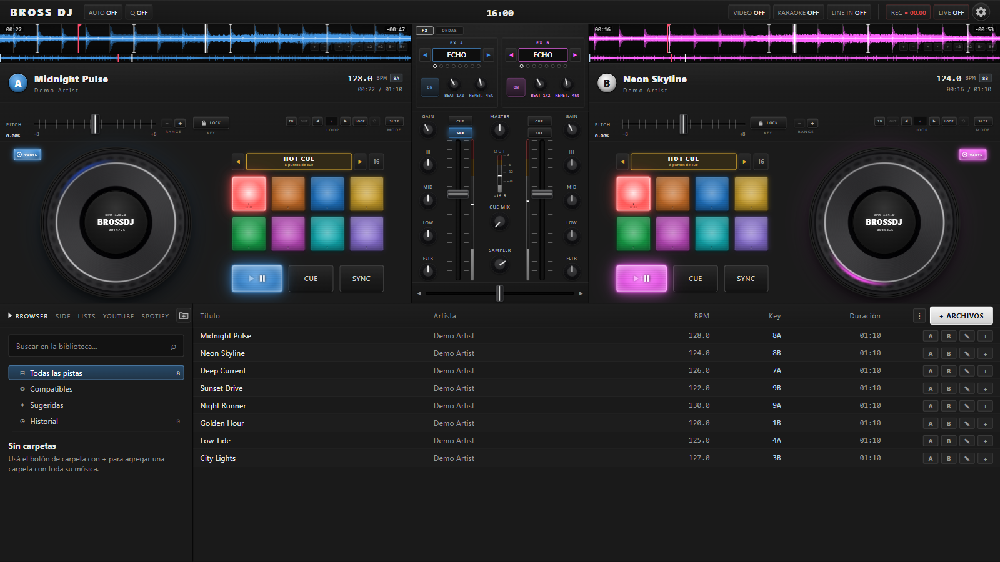
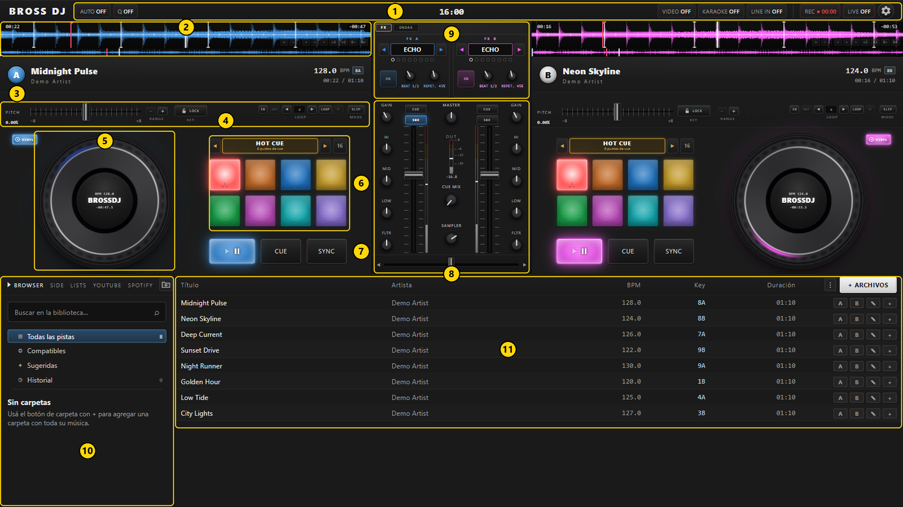

# BROSS DJ

Software de DJ de escritorio para Windows: 2 decks, mixer con EQ y efectos,
sampler, automix, biblioteca con búsqueda, grabación, transmisión en vivo,
video, karaoke, MIDI y DVS. Código propio y abierto (licencia [MIT](LICENSE)).



## Descargar y probar

1. Bajá el instalador `BROSS.DJ.Setup.0.1.0.exe` desde
   [Releases](https://github.com/bross14/bross-dj/releases/latest).
2. Si Windows muestra "Windows protegió su PC", tocá *Más información →
   Ejecutar de todas formas*. Aparece porque el instalador todavía no tiene
   firma de código, no porque tenga un virus.

**¿Es seguro?** El instalador no se compila en la PC de nadie: lo arma GitHub
Actions a partir de este código, y cada release trae su SHA-256 y una
*attestation* que se puede verificar. El programa no envía datos ni
estadísticas. Detalles y cómo comprobarlo en [SECURITY.md](SECURITY.md).

## Cómo se usa



| # | Zona | Para qué sirve |
|---|------|----------------|
| 1 | Barra superior | **AUTO** (automix), **Q** (efectos y saltos al beat), **VIDEO**, **KARAOKE**, **LINE IN**, **REC** (grabar), **LIVE** (transmitir) y el engranaje de **Ajustes**. |
| 2 | Ondas | La onda de cada tema con sus cues y loops. Rueda del mouse = zoom; clic abajo para saltar. |
| 3 | Tema cargado | Título, artista, BPM, tonalidad y tiempo transcurrido / restante. |
| 4 | Pitch y loops | Velocidad del tema, **LOCK** (mantener el tono), loops y **SLIP**. |
| 5 | Plato | Con **VINYL** encendido, arrastrar hace scratch; apagado, empuja el tema para acomodarlo al beat. |
| 6 | Pads | Con las flechas se cambia de modo: HOT CUE, ROLL, LOOPS, SLICER, SAMPLER, STEMS y USER. |
| 7 | Transporte | **Play/pausa**, **CUE** y **SYNC** (iguala el tempo con el otro deck). |
| 8 | Mixer | Ganancia, ecualizador (HI/MID/LOW), filtro, volumen de cada deck, auriculares (**CUE**), master y crossfader. |
| 9 | Efectos | Dos efectos por deck. La pestaña **ONDAS** muestra las dos ondas juntas. |
| 10 | Navegador | Buscador, carpetas, listas, historial, cola del automix (**SIDE**), YouTube y Spotify. El botón de carpeta agrega tu música. |
| 11 | Temas | Doble clic carga en el deck A y Mayús + doble clic en el B (también se puede arrastrar). Clic derecho edita el tema. |

El deck **A** es azul (izquierda) y el **B** magenta (derecha); los dos tienen los mismos controles.
Atajos: **Espacio** play/pausa, **C** CUE, **Shift** cambia de deck y **X** centra el crossfader.

## Sugerencias y errores

¡Me sirve mucho tu opinión! Abrí un
[issue](https://github.com/bross14/bross-dj/issues/new/choose) para:

- **Sugerencia:** algo para agregar, cambiar o quitar.
- **Error:** algo que no funciona, con los pasos para repetirlo.

## Compilarlo desde el código

### Requisitos

- Node.js 20+ (probado con LTS 26)
- npm

### Desarrollo

```bash
npm install
npm run dev        # UI en http://localhost:5173
```

Para abrir la ventana de escritorio (Electron) contra el dev server:

```bash
# terminal 1
npm run dev
# terminal 2 (PowerShell)
$env:VITE_DEV_SERVER_URL="http://localhost:5173"; npm run app
```

### Tests

```bash
npm test           # Vitest: etiquetas, BPM/tonalidad, automix, MIDI, reproductor, biblioteca, grabación
```

Los tests corren sin navegador. El reproductor del hilo de audio (WSOLA, varispeed,
loops) se ejecuta simulando los globales del AudioWorklet y se mide la frecuencia que sale.

### Producción e instalador

```bash
npm run build      # tsc + vite build -> dist/
npm run app        # Electron sirve dist/ en http://127.0.0.1:41731 (solo local)
npm run dist       # instalador de Windows (NSIS) -> release/
```

Las versiones publicadas se compilan con `.github/workflows/release.yml` al
subir un tag `vX.Y.Z` (`git tag v0.1.1; git push origin v0.1.1`).

### Estructura

```
electron/                 proceso principal: ventana, carpetas, biblioteca SQLite,
                          grabación (FLAC/MP3/Ogg en un worker), escritura de etiquetas,
                          streaming (Icecast / red local / RTMP), video (bross-media://),
                          WAV de timecode,
                          servidor local de dist/, migración de ajustes
src/engine/audio.ts       motor de audio (Web Audio): decks, mixer, FX, sampler, sync
src/engine/worklets/      hilo de audio: reproductor del deck (WSOLA + varispeed) y grabador
src/engine/analysis.ts    BPM, rejilla y tonalidad (corre en un worker)
src/engine/tags.ts        etiquetas ID3 / FLAC / OGG / MP4 / WAV (lectura)
src/filterDsl.ts          mini-DSL de las carpetas filtro
src/actionScript.ts       scripts de acciones (pads USER y MIDI)
src/karaoke.ts            letras LRC y gráficos CD+G
src/video/mixer.ts        mezclador de video (canvas)
src/engine/stems.ts       stems por filtros
src/engine/timecode.ts    timecode propio y decodificador DVS
src/i18n.ts, src/skins.ts idioma, skins y addons
src/hooks/                automix, sampler, MIDI, grabación, historial, etiquetas
src/components/           cabina: Toolbar, Waveform, Deck, Jog, Mixer, Browser, YouTube…
src/automix.ts            planificación del automix (silencios, frases)
src/midi.ts, midiDispatch.ts  controladores MIDI: aprendizaje, acciones y luces
tests/                    Vitest
build/icon.png            ícono de la app
tools/generate-art.py     genera las imágenes de la cabina (disco, perillas, faders)
```

## Notas

- La biblioteca vive en `library.db` (SQLite con búsqueda FTS5) dentro de la
  carpeta de datos de la app (`%APPDATA%/bross-dj`, la misma para la app
  instalada y para `npm run app`). Un `library.json` de versiones anteriores se
  importa una sola vez y queda como `library.json.bak`. Solo se leen archivos
  de las carpetas que agregaste o de los archivos que importaste a mano.
- Ajustes → Biblioteca sincroniza la base con una carpeta (OneDrive, Dropbox,
  un pendrive) para usarla en otra PC.
- Las grabaciones van a `Música/BROSS DJ` en WAV, FLAC, MP3 u OGG (Opus), con lista
  de temas .txt, hoja .cue y, si se pide, un archivo por tema. Se puede grabar
  el master, el master + micrófono/línea o todo el sonido del sistema.
- El editor de pista (clic derecho en una fila) escribe las etiquetas en los
  archivos MP3 y FLAC; los demás formatos se editan solo en la biblioteca.
- **LIVE** transmite el master en MP3 a Icecast y/o a un servidor en la red
  local (página para escuchar y pedir temas). **VIDEO** abre el mezclador de
  video (pantalla en otra ventana o monitor, cámara, títulos, imágenes,
  grabación MP4/WebM y RTMP; RTMP usa el ffmpeg instalado). **KARAOKE** maneja
  turnos, tono por cantante y letras `.lrc`/`.cdg` junto al tema. **LINE IN**
  lee el BPM de la entrada.
- **DVS** (Ajustes → DVS) usa un timecode propio: generá el WAV, grabalo en un
  vinilo o CD y conectá el plato a una entrada estéreo.
- Pads: páginas STEMS (voz, bajo, percusión e instrumentos por filtros) y
  USER (scripts de acciones, clic derecho para editar). Los mismos scripts se
  asignan a controles MIDI.
- Ajustes → Interfaz: idioma (español / inglés), skins y addons (JSON).
- Para probar sin tocar la biblioteca real: `BROSS_USER_DATA` (carpeta de
  datos) y `BROSS_REC_DIR` (carpeta de grabaciones).
- El deck de YouTube usa el reproductor oficial: no pasa por EQ, efectos, sync ni grabación.
